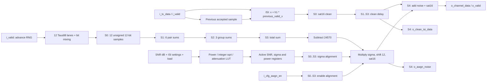

# Channel ISI + AWGN - module handoff specification

- **RTL:** `channel_top.sv`
- **Clock domain:** one rising-edge clock
- **Datapath:** signed 16-bit Q4.12
- **Channel:** two taps, h0=1 and configurable first postcursor h1
- **Noise:** 12-lane Taus88 + CLT approximate Gaussian
- **SNR configuration:** unsigned integer 0..40 dB, explicitly loaded

## 1. Block diagram



All three data outputs refer to the same accepted input sample when o_valid=1.
The valid pipeline advances alongside the data. S4 is a registered output stage.

## 2. I/O interface

### Parameters

| Parameter | Default | Contract |
| --- | --- | --- |
| `DATA_WIDTH` | 16 | Only 16 is supported; other settings trigger an error. |
| `DATA_FRAC` | 12 | Only 12 is supported; other settings trigger an error. |
| `NOISE_SEED` | `32'h00000A5B` | Deterministic seed source for the twelve lanes. |

Q4.12 values are interpreted as signed_integer / 4096. PAM4 amplitudes -3, -1,
+1 and +3 are encoded as `D000`, `F000`, `1000` and `3000` respectively.

### Ports

Directions are relative to `channel_top`. Input controls/data must meet setup
and hold at the rising clock edge. Reset values below describe registered outputs.

| Signal | Direction | Width | Format / purpose | Reset / rule |
| --- | --- | ---: | --- | --- |
| `i_clk` | Input | 1 | Rising-edge clock | Single clock domain. |
| `i_rstn` | Input | 1 | Active-low asynchronous reset | Assert low; synchronize release externally. |
| `i_valid` | Input | 1 | Input sample acceptance | Each high clock accepts one sample; no ready signal. |
| `i_tx_data` | Input | 16 | Signed Q4.12 sample | Used only for valid inputs. |
| `i_cfg_isi_en` | Input | 1 | Enable first-postcursor contribution | Live per accepted sample; 0 bypasses ISI. |
| `i_cfg_isi_coeff` | Input | 16 | Signed Q4.12 h1 | Live per accepted sample; h0 is fixed at 1. |
| `i_cfg_awgn_en` | Input | 1 | Noise injection enable | Captured with the sample; 0 injects zero noise. |
| `i_cfg_snr_db` | Input | 16 | Unsigned integer SNR dB | 0..40; values above 40 clamp to 40 on load. |
| `i_cfg_snr_load` | Input | 1 | Commit SNR and current ISI power calibration | Pulse high for one rising edge; independent of i_valid. |
| `o_cfg_snr_db` | Output | 16 | Active clamped SNR dB | 20. |
| `o_cfg_sigma_q12` | Output | 16 | Active signed Q4.12 noise gain | 916, equivalent to 0.2236328125. |
| `o_cfg_signal_power_q24` | Output | 40 | Nominal clean power, unsigned Q16.24 | 83886080, equivalent to 5. |
| `o_valid` | Output | 1 | Data-valid qualifier for all three sample outputs | 0; input-valid delayed by four clock periods. |
| `o_channel_data` | Output | 16 | Signed Q4.12 clean + injected noise | 0. |
| `o_clean_isi_data` | Output | 16 | Signed Q4.12 clean signal after ISI, aligned with output | 0. |
| `o_awgn_noise` | Output | 16 | Signed Q4.12 actual injected noise, aligned with output | 0; zero for samples with AWGN disabled. |

There is no AXI address decoder, ready/backpressure, FIFO or CDC inside this module.
Do not interpret output data on cycles where o_valid=0.

### Mapping to the system register map

These addresses belong to the enclosing AXI bridge, not to channel_top itself.
The following describes the required connection to the team's existing map:

| System register | Channel connection | Integration detail |
| --- | --- | --- |
| `0x00 CONTROL[0]` | `i_cfg_awgn_en` | Noise enable. |
| `0x08 SNR_DB[7:0]` | `i_cfg_snr_db` | Zero-extend the 8-bit unsigned value to 16 bits; channel clamps >40. |
| `0x04 COMMAND[1]` | `i_cfg_snr_load` | Channel SNR load pulse, high for one core clock. |
| `0x4C CHANNEL_R` | Adapted `o_channel_data` | Existing map specifies signed Q4.4; this module outputs signed Q4.12. |

The channel reset SNR is fixed at 20 dB. If the system bridge uses a different
shadow-register reset, issue a channel load after reset to apply that value.
The three configuration readbacks are direct module ports; no new AXI offsets
are assigned by this handoff. ISI control/coeff wiring must be supplied by the
system integrator because the map above has no ISI configuration register.

A Q4.0 signed TX symbol must be sign-extended and shifted left by 12 before
feeding i_tx_data. To expose this module's output through an existing signed
8-bit Q4.4 boundary, use an arithmetic shift right by 8, clamp to -128..127,
and then narrow to 8 bits. Narrowing without shifting changes the amplitude.
Any adapter/pipeline stages are additional to the channel latency below.

Port-wiring example for the configuration signals:

```systemverilog
.i_cfg_awgn_en  (noise_enable),
.i_cfg_snr_db   ({8'd0, snr_db_u8}),
.i_cfg_snr_load (channel_snr_load),
.o_cfg_snr_db   (),
.o_cfg_sigma_q12(),
.o_cfg_signal_power_q24()
```

The integrator must connect the new load input explicitly and match the sample
formats. An existing Top/legacy wrapper with a different interface is not made
compatible by changing channel_top alone.

## 3. Functional description

### ISI filter

For accepted symbols (n counts valid samples, not all clocks):

    clean[n] = sat16(x[n] + (isi_en ? floor(h1_Q12*x[n-1]/4096) : 0))

The previous-sample register updates only when i_valid=1. A gap in i_valid does
not insert a zero symbol into the history. History still updates while ISI is
bypassed, so a later enabled sample uses the preceding accepted input. Reset
sets the history to zero. Products and the sum remain 32-bit until saturation.

### Gaussian-noise approximation

Each lane combines three 32-bit Tausworthe recurrence states by XOR. The combined
word is mixed with a right shift of 7 and a rotate-left of 11. Lane j extracts
a 12-bit window at offset (4*j) mod 21. The RNG states advance only on accepted
input samples, including samples where noise injection is disabled.

The twelve unsigned values U_j are summed with a pipelined tree:

    z_Q12 = sum(U_j, j=0..11) - 24570

For independent uniform U_j in 0..4095, the exact mean of the sum is 24570 and
interpreting z_Q12 as Q4.12 gives variance 1 - 2^-24. The nearest Q12 normalization
gain is 1.0. Twelve-lane CLT is an approximation: Gaussian tails are not exact,
and different seeds/mixing do not by themselves prove lane independence.

### SNR register and noise gain

For uniformly distributed, zero-mean, uncorrelated PAM4 symbols {-3,-1,+1,+3}:

    E[x^2] = 5
    Pclean = 5*(1+h1^2)     when ISI is enabled
    Pclean = 5              when ISI is bypassed
    sigma = sqrt(Pclean) * 10^(-SNR_dB/20)

On a load, the integer implementation computes:

    power_Q24 = 5*(2^24 + (isi_en ? h1_Q12^2 : 0))
    rms_Q12 = floor(sqrt(power_Q24))
    attenuation_Q24 = round(2^24 * 10^(-SNR_dB/20))
    sigma_Q12 = min(32767, floor((rms_Q12*attenuation_Q24 + 2^23)/2^24))

The attenuation is a 41-entry LUT; the square root is a fixed 20-step restoring
integer operation. Runtime RTL uses no floating-point logarithm/exponential.
The active SNR, sigma and reference power hold until another load or reset.
Changing i_cfg_snr_db alone has no effect. The input ISI controls remain live;
reload SNR after changing them to refresh the power calibration.

This calibration uses nominal signal statistics, not measured frame power.
Correlated/cyclic symbols, other input amplitudes or clipping can change actual
SNR. With correlation, clean power additionally contains 2*h1*E[x[n]*x[n-1]].
The integration must use the appropriate data statistics when interpreting SNR.

### Scaling, output and reset

    noise[n] = awgn_en ? sat16(floor(z_Q12[n]*sigma_Q12/4096)) : 0
    channel[n] = sat16(clean[n] + noise[n])

sat16 clamps to -32768..32767. Negative shifted products round toward minus
infinity. Noise scaling and final addition have separate saturation; the debug
noise output shows the scaled contribution actually selected for injection.
Clipping, especially at low SNR or extreme ISI, changes effective output SNR.

Reset clears output/valid/history/pipeline and restores all lane seeds. Active
SNR resets to 20 dB, sigma_Q12=916 and nominal reference power=5. Load SNR after
reset if a different ISI calibration or SNR is required. Output samples already
in flight are discarded by reset.

## 4. Timing diagram and valid rules

### Latency and throughput

- An input is accepted on every rising edge where i_rstn=1 and i_valid=1.
- There is no backpressure. Maximum rate is one sample per clock.
- An input accepted at edge C0 produces registered output just after edge C4:
  exactly four clock periods later, through five register stages S0..S4.
- No extra gap is required between valid input samples.
- The valid pattern, including bubbles, is reproduced four clock periods later.
- o_channel_data, o_clean_isi_data and o_awgn_noise are aligned to that o_valid.

Pipeline occupancy for one accepted sample:

| Rising edge | C0 | C1 | C2 | C3 | C4 |
| --- | --- | --- | --- | --- | --- |
| Stage | S0 | S1 | S2 | S3 | S4 |
| Noise path | Uniform samples | 6 pair sums | 3 group sums | Total sum | Scale/add/output |
| Clean path | ISI + saturation | Delay | Delay | Delay | Registered output |

The following diagram lists input values sampled on the edge and output values
observed after that same edge. A dash means invalid data; A..E name samples.

```text
Rising edge       C0  C1  C2  C3  C4  C5  C6  C7  C8  C9  C10
i_valid            1   1   0   1   0   1   1   0   0   0    0
i_tx_data          A   B   -   C   -   D   E   -   -   -    -
o_valid            0   0   0   0   1   1   0   1   0   1    1
o_*_data           -   -   -   -   A   B   -   C   -   D    E
```

A/B/C output values include their own ISI and noise processing. A valid bubble
does not stop the pipeline or consume a new RNG/history sample.

### Configuration commit timing

The sample accepted on the load edge uses the previous registered sigma.
Readbacks change after that edge; samples accepted on later edges use the new
sigma. Older samples retain their own pipelined gain and enable.

```text
Rising edge             L-1        L          L+1        L+2
i_cfg_snr_db            new        new         new        new
i_cfg_snr_load            0          1           0          0
i_valid                  1          1           1          1
Gain captured by sample old        old         new        new
Readback after edge     old        new         new        new
```

For an unambiguous startup/configuration epoch, hold i_valid=0 while pulsing
load, deassert load, then start the stream on the following edge. When changing
an already-running stream, the output reflects the corresponding sample's
configuration after its four-clock latency; do not classify outputs only from
the current readback value. Reset is the only operation that flushes the pipeline.

## 5. Block simulation

The channel-specific bench and simulator files are grouped under
`01_bench/channel/` and `10_sim/channel/`. Run from the project root:

```bash
make -C 10_sim/channel -f isi_awgn.mk lint run
make -C 10_sim/channel -f isi_awgn.mk wave
make -C 10_sim/channel -f isi_awgn.mk snr-wave
```

See [channel simulation](../../10_sim/channel/README.md). Generated outputs go to
the ignored `10_sim/build/channel_awgn/` directory.

## 6. Algorithm references

- Pierre L'Ecuyer, *Maximally Equidistributed Combined Tausworthe Generators*,
  Mathematics of Computation 65(213), 203-213, 1996.
  [DOI / article](https://doi.org/10.1090/S0025-5718-96-00696-5).
- David B. Thomas, Wayne Luk, Philip H. W. Leong and John D. Villasenor,
  *Gaussian Random Number Generators*, ACM Computing Surveys 39(4), 2007.
  [DOI / article](https://doi.org/10.1145/1287620.1287622).
- [MathWorks AWGN signal-power/SNR convention](https://www.mathworks.com/help/comm/ref/awgn.html).
