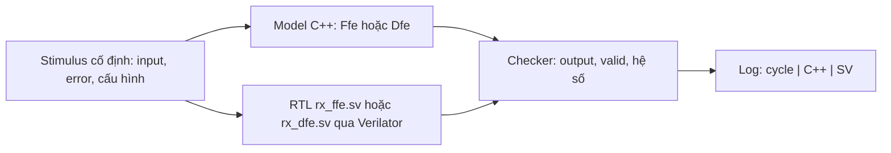
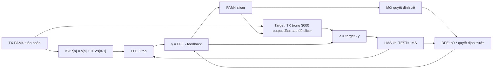
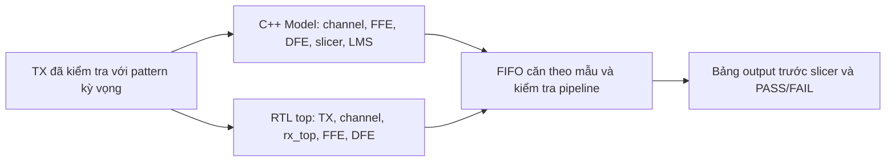

# Kiểm tra FFE / DFE: model C++ và SystemVerilog

Bộ test cấp cùng dữ liệu cho model C++ và RTL thật qua Verilator, rồi so sánh chính xác từng số nguyên fixed-point. Có ba chế độ: FFE riêng, DFE riêng và chuỗi FFE + DFE. Mỗi chế độ có hệ số cố định hoặc cập nhật LMS.

## Chuẩn bị

Chạy trong Ubuntu hoặc Ubuntu WSL. Cần GNU Make, compiler C++17 và Verilator; GTKWave dùng khi muốn mở waveform.

```bash
sudo apt update
sudo apt install build-essential verilator gtkwave
cd ~/adaptive_eq/02_test/eq_independent
```

Nếu clone repo vào đường dẫn khác, thay `~/adaptive_eq` bằng thư mục repo của bạn. Không cần Python hoặc MATLAB để chạy bộ test này.

## Các lệnh chạy

| Chế độ | Hệ số cố định | Cập nhật LMS |
| --- | --- | --- |
| FFE riêng | `make MODE=FFE_ONLY TEST=FIXED` | `make MODE=FFE_ONLY TEST=LMS` |
| DFE riêng | `make MODE=DFE_ONLY TEST=FIXED` | `make MODE=DFE_ONLY TEST=LMS` |
| FFE + DFE | `make MODE=FFE_DFE TEST=FIXED` | `make MODE=FFE_DFE TEST=LMS` |

`make` không có option mặc định chạy `DFE_ONLY`, `FIXED`, 128 mẫu.

```bash
# Chọn số mẫu:
make MODE=FFE_ONLY TEST=LMS N=4096

# Chỉ xuất waveform:
make MODE=DFE_ONLY TEST=FIXED N=128 DUMPWAVE=1

# Xuất waveform và tự mở GTKWave sau khi PASS:
make MODE=FFE_DFE TEST=LMS N=10000 OPENWAVE=1

# Xóa log, waveform, viewer log và thư mục build:
make clean

# Xem các option:
make help
```

| Option | Mặc định | Ý nghĩa |
| --- | --- | --- |
| `MODE` | `DFE_ONLY` | `FFE_ONLY`, `DFE_ONLY`, `FFE_DFE` |
| `TEST` | `FIXED` | `FIXED` giữ hệ số; `LMS` cập nhật hệ số |
| `N` | `128` | Số mẫu input, từ 1 đến 10000000; bảng in đủ N output |
| `DUMPWAVE` | `0` | `1` xuất waveform VCD |
| `OPENWAVE` | `0` | `1` tự bật dumpwave và mở GTKWave |
| `GTKWAVE` | `gtkwave` | Đường dẫn chương trình GTKWave nếu cần thay đổi |
| `JOBS` | `2` | Số tiến trình biên dịch song song |

Build và log được ghi đè khi chạy lại cùng chế độ. GTKWave cần môi trường GUI, ví dụ WSLg. Nếu mở thất bại, VCD vẫn còn và thông báo nằm trong viewer log. `make clean` xóa build nên lần chạy kế tiếp biên dịch lại từ đầu.

## Đọc log

Log hiện ngay trên terminal và lưu ngay trong thư mục `eq_independent`:

```text
DFE_ONLY_FIXED.log
DFE_ONLY_FIXED.vcd          # khi DUMPWAVE=1 hoặc OPENWAVE=1
DFE_ONLY_FIXED_viewer.log   # khi OPENWAVE=1
```

Tên file tương ứng là `<MODE>_<TEST>.log`, `<MODE>_<TEST>.vcd` và `<MODE>_<TEST>_viewer.log`. Luồng chạy mặc định không tạo CSV hay Markdown result.

```text
|      cycle |        output C++ (Q12 / real) |         output SV (Q12 / real) |
|          3 |                   -6144 (-1.5) |                   -6144 (-1.5) |
|          4 |                   -2048 (-0.5) |                   -2048 (-0.5) |
|          5 |                     2048 (0.5) |                     2048 (0.5) |
```

Mỗi ô ghi `số nguyên Q4.12 (giá trị thập phân)`, với giá trị thực = số nguyên / 4096. Phần thập phân hiển thị chính xác tới 1 LSB. Cycle là số cạnh lên tính từ đầu mô phỏng, bắt đầu ở 1 và bao gồm reset; chỉ in cycle có output hợp lệ. Vì vậy output đầu tiên có thể ở cycle 3 hoặc muộn hơn, tùy pipeline.

Cuối log có `PASS` hoặc `FAIL`, số output và số mismatch. So sánh số nguyên chính xác: lệch 1 LSB cũng FAIL, không dùng tolerance. Checker so cả output, valid và hệ số; ở chuỗi tích hợp còn so TX, channel, decision, error, số mẫu và trạng thái training. `make` trả mã lỗi khi có mismatch hoặc lỗi build.

## Model đang dùng

Driver chung là [`../table_test.cpp`](../table_test.cpp). Phần số học và stimulus của FFE/DFE riêng nằm trong [`reference_model.hpp`](reference_model.hpp). Verilator biên dịch trực tiếp RTL trong `00_src`, không dùng mô hình SV giả thay FFE/DFE.

### FFE_ONLY và DFE_ONLY



Hai khối chạy độc lập. Error đã biết được cấp cho cả hai phía, không lấy từ output RTL. Error tới RTL trễ một cạnh clock so với input; output được so với hệ số trước update, còn hệ số được kiểm tra sau update tương ứng. Cuối test có một cạnh flush để kiểm tra lần cập nhật cuối.

| Chế độ | Input Q12 | Hệ số khởi tạo Q12 | Output trong bảng |
| --- | --- | --- | --- |
| `FFE_ONLY` | `[0,4096,-4096,12288,-12288,8191,-8193,1,-1,32767,-32768]` | `w=[1024,3072,-512]` = `[0.25,0.75,-0.125]` | Tổng lọc ba tap |
| `DFE_ONLY` | `[-12288,-4096,4096,12288]` = `[-3,-1,+1,+3]` | `b0=2048` = `0.5` | Feedback `b0 * d_hat[n-1]` |

Stimulus cơ sở có 128 mẫu. Các pattern input/error được tạo theo chỉ số trong 128 mẫu này rồi lặp nguyên đoạn khi N lớn hơn 128; lịch sử mẫu FFE vẫn được giữ liên tục. Error Q12 là `[1,-1,2048,-2048,8192,-8192,0]`. Khi FIXED, error không làm đổi hệ số. Khi LMS, `mu_Q16=32`, tương ứng 32/65536.

Công thức (giá trị thực, trước quy tắc lượng tử hóa):

```text
FFE: y[n] = w0*x[n] + w1*x[n-1] + w2*x[n-2]
     wk   <- wk + mu*e[n]*x[n-k]

DFE: feedback[n] = b0*d_hat[n-1]
     b0          <- b0 - mu*e[n]*d_hat[n-1]
```

Output DFE riêng là phần feedback, chưa phải tín hiệu sau khi trừ khỏi FFE. LMS ở hai chế độ riêng kiểm tra phép cập nhật với error cấp sẵn, không đánh giá tự hội tụ.

### FFE_DFE: nối chuỗi và LMS vòng kín



Hai nhánh C++/SV tính riêng cùng chuỗi:



Wrapper [`../eq_chain/chain_tb.sv`](../eq_chain/chain_tb.sv) chỉ đưa tín hiệu debug ra ngoài; datapath là RTL thật. C++ tự tính kênh từ TX và mẫu TX trước. Decision feedback của model lấy từ slicer C++, không lấy từ quyết định SV để che sai khác. FIFO giữ thứ tự mẫu qua channel/RX, không tự tìm phase hoặc delay để làm khớp kết quả.

| Tham số | FIXED | LMS |
| --- | --- | --- |
| TX Q12 | `[-4096,4096,12288,-12288]` tuần hoàn | Như FIXED |
| ISI Q12 | `2048` = 0.5 | Như FIXED |
| AWGN | Tắt | Tắt |
| FFE ban đầu Q12 | `[4096,0,0]` | `[4096,0,0]` |
| DFE ban đầu Q12 | `2048` = 0.5 | `0` |
| Mu Q16 | `32`, không cập nhật vì LMS tắt | `32` |
| Target error | Quyết định slicer; không cập nhật | TX ở ID 0–2999, slicer từ ID 3000 |
| Output log | FFE trừ feedback, trước slicer | Như FIXED |

TRAIN_LEN=3000 là tham số RTL mặc định của wrapper. N=128 chỉ chạy đoạn đầu training; dùng N>3000 để đi qua giai đoạn decision-directed, ví dụ N=10000 hoặc 200000. Global LMS cũng có thể cập nhật hệ số của khối bypass trong các regression khác; chế độ FFE_DFE ở đây bật cả hai khối.

### Số học fixed-point và nguồn tham chiếu

- Input, error, output và hệ số visible: signed 16-bit, 12 bit phần lẻ.
- FFE: dịch phải số học mỗi tích 12 bit, bão hòa từng tích về 16 bit, rồi cộng và bão hòa tổng.
- DFE: nhân hệ số với quyết định trước, dịch phải số học rồi bão hòa 16 bit.
- LMS: accumulator signed 40-bit, 20 bit phần lẻ. Mu Q16 chuyển sang Q20 bằng nhân 16; delta Q20 = round(mu_Q20 * e_Q12 * x_Q12 / 2^24). FFE cộng delta; DFE trừ delta. Bão hòa accumulator 40 bit, round khi chuyển về hệ số Q12 rồi bão hòa 16 bit.
- Round đúng nửa LSB ra xa 0; dịch phải tích âm làm tròn xuống. Slicer chọn mức thấp khi đúng ngưỡng -2, 0, +2.

Model số học được chuyển từ các hàm `dfe_lms_pam_fp_core`, `lms_delta_qacc`, `q_sat` và chuyển Q-format trong [`../../reference/full_demo_v26_clt_awgn_fixed_paper.m`](../../reference/full_demo_v26_clt_awgn_fixed_paper.m). Đây là phần số học plain LMS: không robust clipping, projection, gate hoặc Polyak averaging. C++ đã có kiểm tra giá trị tính tay trong `reference_checks.cpp`; chưa xác minh tương đương bằng một lần chạy MATLAB runtime.

PASS nghĩa là C++ và RTL khớp ở các mẫu đã chạy; không đồng nghĩa tự hội tụ. Luồng bảng này chưa tự báo mốc hội tụ, chưa kiểm tra AWGN, synthesis/timing hoặc board thật.

## File thực thi và regression cũ

| File | Vai trò |
| --- | --- |
| `Makefile` | Entry point; chuyển option sang `../Makefile` |
| `../Makefile` | Build, chạy, lưu log, dump/open wave và clean |
| `../table_test.cpp` | Driver bảng ba chế độ, clock và waveform |
| `reference_model.hpp` | Số học C++ và stimulus độc lập |
| `../eq_chain/chain_tb.sv` | Wrapper probe cho RTL tích hợp |
| `reference_checks.cpp` | Kiểm tra contract số học bằng giá trị tính tay |
| `driver.cpp`, `export_vectors.m`, `RESULTS.md` | Regression CSV và báo cáo lịch sử |

Chạy kiểm tra số học bằng `make reference_checks`. Các target cũ `make ffe`, `make dfe`, `make all` vẫn xuất CSV vào `results/`; chúng không phải luồng log bảng mặc định. Các script Python đã được gỡ.
