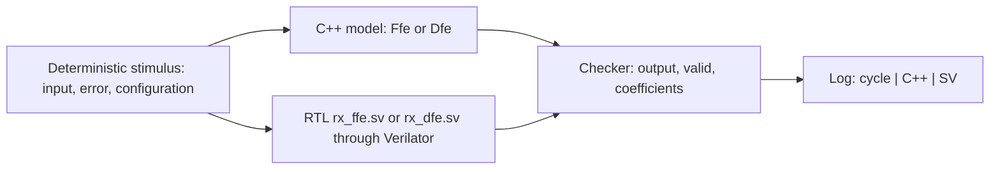
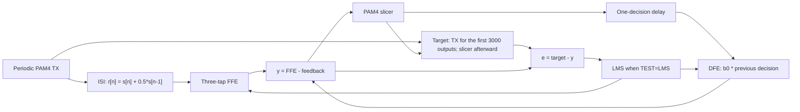
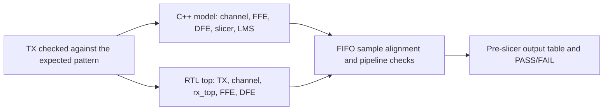

# FFE / DFE Tests: C++ Model and SystemVerilog

This test suite feeds the same data to an independent C++ model and the actual RTL simulated by Verilator, then compares their fixed-point integer results exactly. It supports three modes: standalone FFE, standalone DFE, and a connected FFE + DFE chain. Each mode supports fixed coefficients or LMS adaptation.

## Requirements

Run the tests on Ubuntu or Ubuntu WSL. GNU Make, a C++17 compiler, and Verilator are required. GTKWave is optional and is used to view waveforms.

```bash
sudo apt update
sudo apt install build-essential verilator gtkwave
cd ~/adaptive_eq/02_test/eq_independent
```

Replace `~/adaptive_eq` with your repository path if necessary. Python and MATLAB are not required to run this suite.

## Running the Tests

| Mode | Fixed coefficients | LMS adaptation |
| --- | --- | --- |
| Standalone FFE | `make MODE=FFE_ONLY TEST=FIXED` | `make MODE=FFE_ONLY TEST=LMS` |
| Standalone DFE | `make MODE=DFE_ONLY TEST=FIXED` | `make MODE=DFE_ONLY TEST=LMS` |
| FFE + DFE | `make MODE=FFE_DFE TEST=FIXED` | `make MODE=FFE_DFE TEST=LMS` |

Running `make` without options defaults to `DFE_ONLY`, `FIXED`, and 128 input samples.

```bash
# Select the number of samples:
make MODE=FFE_ONLY TEST=LMS N=4096

# Dump a waveform without opening it:
make MODE=DFE_ONLY TEST=FIXED N=128 DUMPWAVE=1

# Dump a waveform and open GTKWave after the test passes:
make MODE=FFE_DFE TEST=LMS N=10000 OPENWAVE=1

# Remove logs, waveforms, viewer logs, and build directories:
make clean

# Show the available options:
make help
```

| Option | Default | Description |
| --- | --- | --- |
| `MODE` | `DFE_ONLY` | `FFE_ONLY`, `DFE_ONLY`, or `FFE_DFE` |
| `TEST` | `FIXED` | `FIXED` holds coefficients; `LMS` updates them |
| `N` | `128` | Number of input samples, from 1 to 10000000; the table prints all N outputs |
| `DUMPWAVE` | `0` | Set to `1` to generate a VCD waveform |
| `OPENWAVE` | `0` | Set to `1` to enable waveform dumping and open GTKWave automatically |
| `GTKWAVE` | `gtkwave` | Override the GTKWave executable path if necessary |
| `JOBS` | `2` | Number of parallel compilation jobs |

Build artifacts and logs are overwritten when the same mode is run again. GTKWave requires a graphical environment, such as WSLg. If the viewer fails to open, the VCD remains available and diagnostic messages are saved in the viewer log. Since `make clean` removes build directories, the next run rebuilds the executable.

## Reading the Log

The log is printed directly in the terminal and saved in the `eq_independent` directory:

```text
DFE_ONLY_FIXED.log
DFE_ONLY_FIXED.vcd          # when DUMPWAVE=1 or OPENWAVE=1
DFE_ONLY_FIXED_viewer.log   # when OPENWAVE=1
```

The filename patterns are `<MODE>_<TEST>.log`, `<MODE>_<TEST>.vcd`, and `<MODE>_<TEST>_viewer.log`. The default table runner does not generate CSV files or Markdown result reports.

```text
|      cycle |        output C++ (Q12 / real) |         output SV (Q12 / real) |
|          3 |                   -6144 (-1.5) |                   -6144 (-1.5) |
|          4 |                   -2048 (-0.5) |                   -2048 (-0.5) |
|          5 |                     2048 (0.5) |                     2048 (0.5) |
```

Each output cell contains a `Q4.12 integer (decimal value)`, where the real value equals the integer divided by 4096. The decimal representation is exact down to one LSB. The cycle column counts rising clock edges from the start of simulation, beginning at 1 and including reset. Only cycles with valid output are printed, so the first output may appear at cycle 3 or later, depending on the pipeline.

The final line reports `PASS` or `FAIL`, the output count, and the mismatch count. Comparison uses exact integers: a difference of one LSB fails the test, with no numerical tolerance. The checker compares output, valid, and coefficients. For the integrated chain, it also checks TX data, channel output, decisions, error, sample counts, and training state. `make` returns a nonzero exit code on a mismatch or build failure.

## Models Used by the Test Suite

The shared driver is [`../table_test.cpp`](../table_test.cpp). Arithmetic and stimulus generation for the standalone FFE/DFE tests are implemented in [`reference_model.hpp`](reference_model.hpp). Verilator compiles the actual RTL in `00_src`; behavioral replacements are not used for the FFE or DFE.

### FFE_ONLY and DFE_ONLY



The two blocks run independently. A known error sequence is supplied to both implementations rather than derived from the RTL output. Error reaches the RTL one rising edge after the corresponding input. Output is compared using coefficients before that sample's update; coefficients are checked after the matching update. A final flush edge checks the last coefficient update.

| Mode | Q12 input | Initial Q12 coefficients | Output shown in the table |
| --- | --- | --- | --- |
| `FFE_ONLY` | `[0,4096,-4096,12288,-12288,8191,-8193,1,-1,32767,-32768]` | `w=[1024,3072,-512]` = `[0.25,0.75,-0.125]` | Three-tap filter output |
| `DFE_ONLY` | `[-12288,-4096,4096,12288]` = `[-3,-1,+1,+3]` | `b0=2048` = `0.5` | Feedback `b0 * d_hat[n-1]` |

The base stimulus contains 128 samples. Input and error patterns are generated by index within that block, and the entire block repeats when N exceeds 128; FFE sample history remains continuous. The Q12 error pattern is `[1,-1,2048,-2048,8192,-8192,0]`. In FIXED mode, error does not change coefficients. In LMS mode, `mu_Q16=32`, equivalent to 32/65536.

The equations below use real values before fixed-point quantization:

```text
FFE: y[n] = w0*x[n] + w1*x[n-1] + w2*x[n-2]
     wk   <- wk + mu*e[n]*x[n-k]

DFE: feedback[n] = b0*d_hat[n-1]
     b0          <- b0 - mu*e[n]*d_hat[n-1]
```

Standalone DFE output is the feedback term, before subtraction from the FFE output. LMS tests in these two standalone modes verify coefficient updates with supplied error; they do not measure convergence.

### FFE_DFE: Connected Chain and Closed-Loop LMS



The C++ and SV paths independently process the same sequence:



The wrapper [`../eq_chain/chain_tb.sv`](../eq_chain/chain_tb.sv) only exposes debug signals; the datapath uses the actual RTL. C++ computes channel output from the current and previous TX symbols. Model feedback uses the C++ slicer's previous decision, not the SV decision, so discrepancies are not hidden. FIFOs preserve sample order through the channel and RX; the checker does not search for a phase or delay that makes results match.

| Parameter | FIXED | LMS |
| --- | --- | --- |
| TX Q12 | Repeating `[-4096,4096,12288,-12288]` | Same as FIXED |
| ISI Q12 | `2048` = 0.5 | Same as FIXED |
| AWGN | Disabled | Disabled |
| Initial FFE Q12 | `[4096,0,0]` | `[4096,0,0]` |
| Initial DFE Q12 | `2048` = 0.5 | `0` |
| Mu Q16 | `32`; updates disabled | `32` |
| Error target | Slicer decision; updates disabled | TX at sample IDs 0-2999; slicer from ID 3000 |
| Logged output | FFE minus feedback, before the slicer | Same as FIXED |

TRAIN_LEN=3000 is the wrapper's default RTL parameter. N=128 runs only the beginning of training. Set N>3000 to reach decision-directed operation, for example N=10000 or 200000. Global LMS can also update coefficients of bypassed blocks in other regressions; FFE_DFE mode enables both blocks.

### Fixed-Point Arithmetic and Reference Source

- Input, error, output, and visible coefficients use signed 16-bit values with 12 fractional bits.
- FFE: arithmetic-shift each product right by 12 bits, saturate each product to 16 bits, then add and saturate the sum.
- DFE: multiply the coefficient by the previous decision, arithmetic-shift right, and saturate to 16 bits.
- LMS: use a signed 40-bit accumulator with 20 fractional bits. Convert mu from Q16 to Q20 by multiplying by 16. The Q20 delta is round(mu_Q20 * e_Q12 * x_Q12 / 2^24). Add delta for FFE and subtract it for DFE. Saturate the accumulator to 40 bits, round when converting back to Q12, then saturate the visible coefficient to 16 bits.
- Exact half-LSB ties round away from zero. Right shifts of negative products round downward. The slicer selects the lower level at exact thresholds -2, 0, and +2.

The arithmetic model is derived from `dfe_lms_pam_fp_core`, `lms_delta_qacc`, `q_sat`, and Q-format conversion in [`../../reference/full_demo_v26_clt_awgn_fixed_paper.m`](../../reference/full_demo_v26_clt_awgn_fixed_paper.m). It implements plain LMS without robust clipping, projection, gating, or Polyak averaging. Hand-calculated arithmetic checks are provided in `reference_checks.cpp`; direct equivalence against a MATLAB runtime execution has not been verified.

PASS means C++ and RTL match for the samples tested; it does not imply convergence. The table runner does not automatically report convergence time and does not validate AWGN, synthesis/timing, or FPGA board operation.

## Implementation Files and Legacy Regression

| File | Purpose |
| --- | --- |
| `Makefile` | Entry point; forwards options to `../Makefile` |
| `../Makefile` | Build, run, log, dump/open waveforms, and clean |
| `../table_test.cpp` | Three-mode table driver, clock, and waveform handling |
| `reference_model.hpp` | Independent C++ arithmetic and stimulus generation |
| `../eq_chain/chain_tb.sv` | Probe wrapper for the integrated RTL |
| `reference_checks.cpp` | Hand-calculated arithmetic contract checks |
| `driver.cpp`, `export_vectors.m` | Legacy CSV regression and MATLAB vector export |

Run `make reference_checks` for the arithmetic checks. The legacy targets `make ffe`, `make dfe`, and `make all` still generate CSV files under `results/`; they are separate from the default table runner. Python scripts have been removed.
