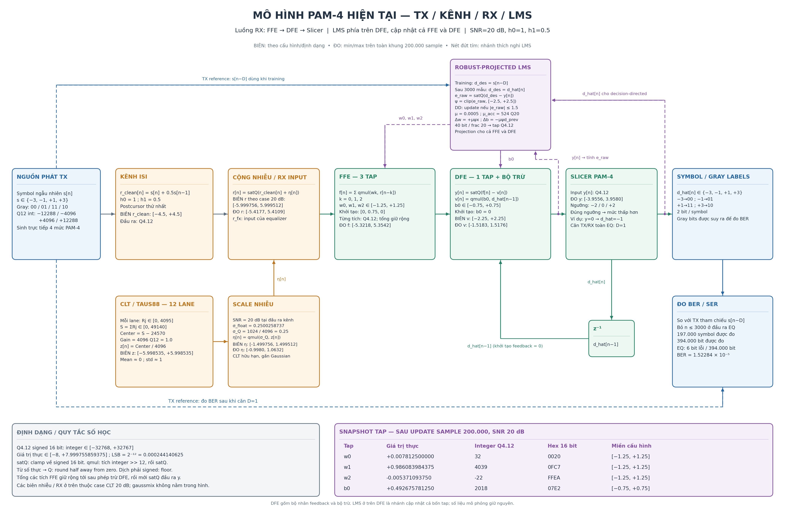

# Sơ đồ model PAM-4 hiện tại và các miền giá trị

Bản tiếng Anh chi tiết mới, có hai nhánh LMS riêng và các cổng P01–P24:
[English architecture and interfaces](PAM4_CURRENT_MODEL_EN.md).



Bản vector để phóng lớn: [SVG](figures/pam4_current_model.svg),
[PDF](figures/pam4_current_model.pdf).

Sơ đồ bám theo case **Python adaptive robust_proj, SNR=20 dB, h0=1, h1=0.5**.
Các min/max đo được lấy từ toàn bộ 200000 sample đã lưu trong
`10_sim/python_v26_signals/gaussian_20db_vectors.npz`.

Luồng chính được trình bày **FFE → DFE → Slicer**. Khối DFE bao gồm bộ nhân
feedback b0*d_hat[n-1] và phép trừ khỏi đầu ra FFE. LMS nằm phía trên DFE,
với đường cập nhật b0 xuống DFE và w0/w1/w2 sang FFE. Vòng feedback qua z^-1
nằm dưới DFE/Slicer. Đây là thay đổi bố cục; số liệu và thuật toán giữ nguyên.

Trong hình, **BIÊN** là giới hạn suy từ cấu hình/định dạng; **ĐO** là min/max
thực tế trong khung. Snapshot tap là giá trị sau cập nhật sample 200000.

| Tín hiệu / hệ số | Miền theo cấu hình |
| --- | --- |
| Signal/tap Q4.12 signed 16 bit | [-8, 7.999755859375], LSB=0.000244140625 |
| TX s[n] | {-3,-1,+1,+3} |
| Kênh sạch s[n]+0.5s[n-1] | [-4.5,+4.5] |
| Uniform mỗi lane, 12 bit | [0,4095] |
| Tổng 12 lane | [0,49140] |
| Sau trừ tâm 24570 | [-24570,+24570], integer |
| Nhiễu CLT đơn vị z | [-5.99853515625,+5.99853515625] |
| Sigma Q4.12 ở case 20 dB | 1024/4096 = 0.25 |
| Nhiễu đã scale eta | [-1.499755859375,+1.49951171875] |
| RX sau cộng nhiễu | [-5.999755859375,+5.99951171875] |
| Mỗi tap FFE w0,w1,w2 | [-1.25,+1.25] |
| Tap DFE b0 | [-0.75,+0.75] |
| Feedback b0*d_hat[n-1] | [-2.25,+2.25] |
| Error sau clipping | [-2.5,+2.5] |
| Điều kiện cập nhật trong DD | abs(e_raw)<=1.5 |

Các biên nhiễu/RX trên chỉ áp dụng case CLT 20 dB trong hình, với rounding và
saturation đúng theo model. Mô hình gaussmix có thêm khuếch đại impulse nên
không dùng cùng các biên này. Tổng các tích FFE được giữ rộng trước khi trừ DFE;
đầu ra y mới được clamp về signed 16 bit. Nhánh LMS tích lũy 40 bit/20 bit phần
lẻ, rồi lượng tử hóa tap nhìn thấy về Q4.12.

Ví dụ các min/max đo được:

| Đại lượng | Min | Max |
| --- | ---: | ---: |
| Noise đã scale | -0.998046875 | 1.063232421875 |
| RX r[n] | -5.417724609375 | 5.410888671875 |
| Tổng FFE f[n] | -5.32177734375 | 5.354248046875 |
| Feedback DFE v[n] | -1.518310546875 | 1.517578125 |
| Sau EQ y[n] | -3.95556640625 | 3.9580078125 |

Một bộ LMS cập nhật cả ba tap FFE và tap DFE. Training dùng s[n-D] trong 3000
sample đầu, sau đó dùng quyết định slicer. D=1 mô tả căn symbol TX/RX của toàn
equalizer; sơ đồ này là model symbol-rate, chưa xác định pipeline clock cho RTL.

Slicer giữ quy tắc của code: tại ngưỡng chọn mức thấp hơn. TX sinh trực tiếp
symbol PAM-4 ngẫu nhiên; Gray bits được suy ra để đo BER. Cửa sổ BERT sau
training có 197000 symbol / 394000 bit, quan sát 6 bit lỗi ở case này.

Tái tạo hình và bảng range:

```bash
python3 03_script/draw_current_model.py
```

Script đọc config, snapshot tap và vectors; dựng lại toàn bộ FFE/DFE từ lịch sử
tap rồi kiểm tra output khớp y_fx trước khi vẽ. Bảng số máy đọc được nằm trong
`figures/pam4_current_model_ranges.json`.
