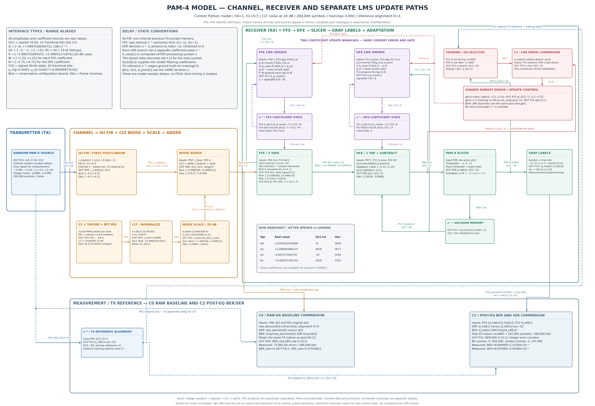
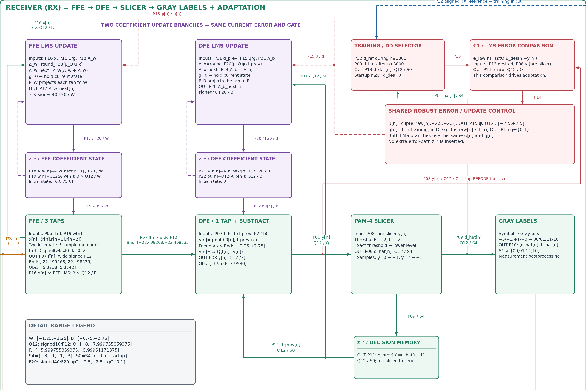

# Current PAM-4 model: English architecture and signal interfaces



Full-resolution files: [SVG](figures/pam4_current_model_en.svg),
[PDF](figures/pam4_current_model_en.pdf).



Receiver-detail files: [SVG](figures/pam4_lms_detail_en.svg),
[PDF](figures/pam4_lms_detail_en.pdf).

Every connection has an interface identifier P01–P24. Output names, types and
bounds are shown at their source blocks. The complete catalogue is available as
[a table](figures/pam4_model_interfaces_en.md),
[CSV](figures/pam4_model_interfaces_en.csv), and
[JSON](figures/pam4_model_interfaces_en.json).

The diagram describes the saved **Python robust-projected LMS case at 20 dB**,
h0=1, h1=0.5, 200000 symbols, 3000 training samples and decision alignment D=1.
Amplitude/coefficient ranges are expressed as real values; URNG words and error
counters are integers. Conservative bounds and measured frame min/max are
labelled separately. The simulation algorithm and its results are unchanged.

## Block boundaries

- **TX:** directly generates random PAM-4 symbols s[n] in {-3,-1,+1,+3}.
  Gray labels are associated with symbols for measurement. This source is not PRBS.
- **Channel:** first-postcursor ISI FIR, twelve Taus88 generators with bit
  mixing/extraction, CLT summation/centering/normalization, noise scaling and
  the saturating noise adder. Its final output is P06 r[n], the RX input.
- **RX:** FFE, DFE subtraction, PAM-4 slicer and Gray labels, plus their adaptive
  control paths. The FFE has two sample-history delays. The DFE includes the
  feedback product and subtraction, with a separate previous-decision memory.
- **Measurement/reference:** TX alignment for training and post-EQ measurement,
  the raw-RX baseline comparator C0 and the post-EQ comparator C2.

## The three comparison points

| Point | Signal being checked | Reference / alignment | Purpose |
| --- | --- | --- | --- |
| C0, before FFE | slice(r[k]) | Original s[k], delay 0 | Raw-channel BER/SER baseline |
| C1, after DFE and before slicer | Pre-slicer y[n] | d_des[n]: aligned TX during training, current slicer decision during DD | Calculate e_raw[n]=satQ(d_des[n]-y[n]) for adaptation |
| C2, after decisions/Gray mapping | d_hat[n] and its two Gray bits | d_ref[n]=s[n-D], D=1 | Post-EQ SER and BER |

During training n<=3000, the selector uses d_ref[n]. Afterwards it uses
d_hat[n]. Startup n<=D uses a zero desired value. C1 error is clipped to
psi[n] in [-2.5,+2.5]. The update gate is always enabled during training and is
enabled in decision-directed mode when abs(e_raw[n])<=1.5.

C0 and C2 retain the same transmitted-symbol window: TX indices 3000..199999,
corresponding to EQ output indices 3001..200000 (one-based). Therefore each
measures 197000 symbols / 394000 bits. C0 does not apply the EQ's extra delay
to its own raw received samples.

## Separate FFE and DFE LMS branches

The original update loop already has two coefficient-update equations. The
diagram now exposes them as two functional blocks, sharing the same current
psi[n] and gate g[n]:

```text
FFE LMS:
  Delta_w[n]   = round_F20(mu_Q * psi[n] * x[n])
  A_w_next[n]  = project_W(sat40(A_w[n] + Delta_w[n]))

DFE LMS:
  Delta_b[n]   = round_F20(mu_Q * psi[n] * d_hat[n-1])
  A_b_next[n]  = project_B(sat40(A_b[n] - Delta_b[n]))
```

If g[n]=0, both branches hold their current state. The minus sign in the DFE
update follows from subtracting its feedback product in y[n]. Here
mu_Q=524/2^20, W=[-1.25,+1.25] per FFE tap, and B=[-0.75,+0.75].

The accumulator signals have 40 signed bits and 20 fractional bits; their
projected real-value bounds are W and B. The visible filtering coefficients
are rounded/saturated back to signed Q4.12.

## Explicit z^-1 memories

| Memory | Stored quantity | Initial state | Output |
| --- | --- | --- | --- |
| Internal ISI delay | Previous transmitted symbol | 0 | s[n-1] |
| Two internal FFE sample delays | Previous RX samples | 0 | r[n-1], r[n-2] |
| DFE decision memory | Previous slicer decision | 0 | P11 d_prev[n]=d_hat[n-1] |
| FFE LMS coefficient memory | Updated FFE accumulator vector | [0,0.75,0] | P18 A_w[n]=A_w_next[n-1]; P19 w[n]=Q12(A_w[n]) |
| DFE LMS coefficient memory | Updated DFE accumulator | 0 | P21 A_b[n]=A_b_next[n-1]; P22 b0[n]=Q12(A_b[n]) |
| TX reference alignment | Transmitted reference, D=1 | 0 | P12 d_ref[n]=s[n-D] |

These LMS z^-1 blocks represent coefficient-state memory, **not an additional
delay in the error path**. Symbol n is filtered with the old state A[n]. Its
error then produces A_next[n], which becomes A[n+1] for the next symbol.
The diagram therefore preserves the current model's adaptation timing.

The snapshot after updating sample 200000 is [32,4039,-22,2018] in Q4.12
integer units. Those taps are available for filtering sample 200001. Filtering
sample 200000 used the preceding state [35,4041,-23,2019].

## Reproduction and verification

```bash
python3 03_script/draw_current_model_en.py
```

The script reconstructs the saved FFE/DFE filtering outputs and replays both LMS
update equations as separate state machines for all 200000 samples. It checks
both old-state timing and each newly updated visible coefficient vector against
the saved history before exporting the diagrams and port catalogue.

This is a symbol-rate numerical architecture. Actual FPGA pipeline registers,
clock period and hardware throughput still need to be specified during RTL work.
